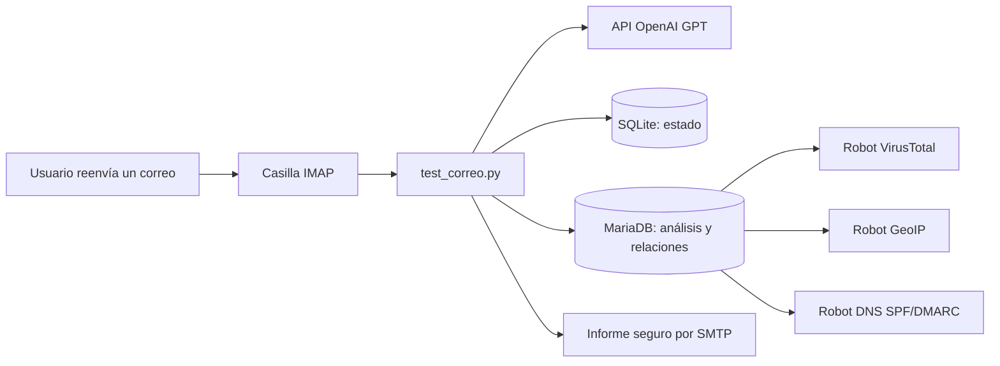

# PhishGuardAI — Backend Python V9

Análisis automatizado de correos electrónicos sospechosos, reportados mediante el botón **Reenviar** de Gmail u otro cliente de correo. PhishGuardAI recibe el reenvío en una casilla IMAP, extrae señales técnicas, solicita a un modelo GPT una evaluación orientativa, registra evidencias en SQLite/MariaDB y responde al usuario con un informe por SMTP. Tres robots independientes enriquecen la información con VirusTotal, GeoIP y DNS.

> **Alcance de este repositorio:** fuentes reales del **backend Python** y esquema de base de datos. El **frontend Next.js no está incluido** porque el ZIP facilitado no contiene sus fuentes. Consulta [`docs/INTEGRACION_FRONTEND.md`](docs/INTEGRACION_FRONTEND.md) para incorporar ese proyecto después.

> **Seguridad:** el contenido del correo no es confiable. La clasificación por IA no constituye una garantía de legitimidad ni una confirmación forense de ataque. **No abras los enlaces ni ejecutes adjuntos para probar el sistema.**

## Funcionalidades

- Recepción IMAP con TLS; identificación incremental mediante `UIDVALIDITY` + `UID`.
- Interpretación de texto plano/HTML MIME, nombres de adjuntos y URLs (sin visitarlas ni ejecutar archivos).
- Análisis GPT (`OPENAI_MODEL`, predeterminado `gpt-5-mini`), salida JSON validada y riesgo orientativo 0–100.
- Categorías: `PHISHING`, `SOSPECHOSO`, `PROBABLEMENTE_LEGITIMO`, `NO_CONCLUYENTE`.
- Asociación analítica a MITRE ATT&CK (`T1566.001`, `T1566.002`, `T1598`, `T1656`) cuando existe evidencia.
- Persistencia SQLite para reutilización del análisis y MySQL/MariaDB para casos, indicadores, eventos y URLs.
- Respuesta automática SMTP (HTML + texto plano) con direcciones neutralizadas como `hxxps://dominio[.]com`.
- Robot VirusTotal API v3: consulta informes **existentes** por URL, no solicita análisis nuevos.
- Robot GeoIP: DNS y bases locales MaxMind GeoLite2 Country/ASN para IP/país/ASN aproximados.
- Robot DNS: publicación SPF y DMARC; **no certifica** SPF, DKIM o DMARC del correo original reenviado.
- V9: detección de cabeceras **citadas** en reenvíos, registradas como evidencia **no verificable**.

## Arquitectura



Para relaciones entre tablas, responsabilidades y criterios de confianza, ver [`docs/ARQUITECTURA.md`](docs/ARQUITECTURA.md).

## Requisitos

- Python **3.10 o superior** y pip; acceso a IMAP SSL (normalmente 993), SMTP SSL (normalmente 465), API OpenAI y DNS.
- Base **MariaDB 11.4** (versión del respaldo de referencia) o MySQL compatible; el esquema no se ha ensayado en todas las versiones.
- Entorno Linux con `bash`, `cron` y `flock` para ejecución periódica (DirectAdmin/hosting).
- Dos bases MaxMind GeoLite2 descargadas por el operador si se utilizará el robot GeoIP.
- Una API key de VirusTotal v3 si se ejecutará el robot VirusTotal.

## Instalación local

```bash
git clone https://github.com/TU-USUARIO/PhishGuardAI-Backend.git
cd PhishGuardAI-Backend
python3 -m venv .venv
source .venv/bin/activate
python -m pip install --upgrade pip
python -m pip install -r requirements.txt
cp .env.example .env
```

Edita `.env` con valores reales y **no lo subas a GitHub**. Verifica permisos con `chmod 600 .env` en Linux. El archivo `.env.example` contiene únicamente valores ficticios.

### Crear la base de datos

Crear una base vacía y usuario SQL con permisos acordes a su función. Después importar el esquema real exportado de MariaDB:

```bash
mysql -u TU_USUARIO -p TU_BASE < database/schema.sql
```

También puedes importarlo desde **phpMyAdmin**, seleccionando antes una base de datos vacía. El esquema incluye ocho tablas: `correos_analizados`, `indicadores_phishing`, `eventos_sistema`, `vt_urls`, `correo_urls`, `usuarios`, `acciones_analista`, `tokens_activacion`.

**Importante:** `database/schema.sql` crea estructura e índices, pero **no** incluye registros de producción. No lo ejecutes sin respaldo sobre una base ya poblada. Si tu proyecto ya tiene estas tablas, no importes el esquema de nuevo: úsalo como documentación.

### Configurar GeoIP

El repositorio **no incluye archivos `.mmdb`** (licencia de datos, tamaño y actualización). Descarga **GeoLite2 Country** y **GeoLite2 ASN** desde tu cuenta MaxMind y pon los archivos `GeoLite2-Country.mmdb` y `GeoLite2-ASN.mmdb` en la raíz del proyecto, o apunta a sus rutas mediante `GEOIP_COUNTRY_DB` y `GEOIP_ASN_DB` en `.env`. El robot fallará con `FileNotFoundError` si no encuentra ambos.

### Primera ejecución

```bash
python test_correo.py
```

La primera ejecución sin `correos.db` inicializa el cursor IMAP al último UID y **omite los correos que ya estaban** en el buzón. Reenvía después un mensaje de prueba; no borres `correos.db` para intentar procesar mensajes anteriores. Se recomienda probar con un buzón aislado antes de usar uno corporativo.

El proceso realiza **seis revisiones** con intervalo aproximado de **10 segundos** en una invocación. El modo principal para hosting es cron, no un servidor HTTP. `passenger_wsgi.py` solo devuelve un mensaje de estado si se configura Passenger; **no es un endpoint de análisis ni una API de frontend**.

### Ejecutar los robots manualmente

```bash
python robot_virustotal.py   # requiere VT_API_KEY
python robot_geoip.py       # requiere las bases GeoLite2
python robot_dns_auth.py    # requiere DNS y MySQL
```

El orden no es rígido, pero primero deben existir registros de análisis y URLs para que las colas tengan trabajo.

## Programación con cron (Linux / DirectAdmin)

Los scripts `cron_*.sh` son portables y usan bloqueo `flock` para evitar ejecuciones simultáneas. Por defecto usan `.venv/bin/python`; si tu panel aloja el virtualenv fuera del proyecto define `PYTHON_BIN`.

```bash
chmod +x cron_*.sh
mkdir -p logs
```

Ejemplo para editar con `crontab -e` **sustituyendo** las rutas por las de tu hosting:

```cron
* * * * cd /RUTA/PhishGuardAI-Backend && PYTHON_BIN=/RUTA/venv/bin/python /bin/bash cron_correo.sh >> logs/correo.log 2>&1
* * * * cd /RUTA/PhishGuardAI-Backend && PYTHON_BIN=/RUTA/venv/bin/python /bin/bash cron_virustotal.sh >> logs/virustotal.log 2>&1
* * * * cd /RUTA/PhishGuardAI-Backend && PYTHON_BIN=/RUTA/venv/bin/python /bin/bash cron_geoip.sh >> logs/geoip.log 2>&1
* * * * cd /RUTA/PhishGuardAI-Backend && PYTHON_BIN=/RUTA/venv/bin/python /bin/bash cron_dns_auth.sh >> logs/dns_auth.log 2>&1
```

El robot VirusTotal realiza hasta **tres consultas por ejecución**, con separación de 20 segundos, y respeta el retorno HTTP 429 mediante reintentos. Controla las cuotas permitidas por tu cuenta. Para una ejecución alternativa permanente existe `listener.py` (IMAP IDLE), **no lo habilites a la vez que el cron** sin diseñar coordinación de estados y prevención de duplicados.

## Estructura del proyecto

| Archivo o carpeta | Función |
|---|---|
| `test_correo.py` | Núcleo IMAP, MIME, clasificación GPT, SQLite y SMTP. |
| `registro_mysql.py` | Inserción de casos, eventos e indicadores; actualización de envíos. |
| `evidencia_reenvio.py` / `autenticacion_registro.py` | Evidencia citada en reenvío y estado de autenticación original. |
| `geo_registro.py` / `robot_geoip.py` | Dominio original citado y enriquecimiento de IP/país/ASN. |
| `vt_cola.py` / `robot_virustotal.py` | Cola de URLs y consultas VirusTotal. |
| `robot_dns_auth.py` | Registros TXT SPF/DMARC del dominio citado. |
| `cron_*.sh` | Ejecución periódica con bloqueos. |
| `listener.py` | Alternativa IMAP IDLE (no usada por los cron). |
| `analizador_ia.py` | Prototipo auxiliar/alternativo, no utilizado por `test_correo.py`. |
| `passenger_wsgi.py` | Página textual de estado opcional. |
| `database/schema.sql` | Esquema sin datos de las ocho tablas de MariaDB. |
| `migracion_attack.sql` | Migración histórica: **no aplicar** sobre el esquema V9 ya completo. |
| `tests/` | Pruebas unitarias locales sin acceso a servicios externos. |

## Pruebas sin credenciales

```bash
python -m unittest discover -s tests -v
python -m compileall -q .
```

Estas pruebas validan la extracción de datos citados de Gmail y la neutralización de enlaces del informe; **no prueban conexiones reales** con OpenAI, MySQL, IMAP, SMTP, VirusTotal, GeoIP ni el frontend.

## Consultas de diagnóstico (solo lectura)

```sql
SELECT id, clasificacion, riesgo, estado_envio, fecha_analisis
FROM correos_analizados ORDER BY id DESC LIMIT 10;

SELECT estado, COUNT(*) AS total
FROM vt_urls GROUP BY estado;

SELECT remitente_geo_estado, COUNT(*) AS total
FROM correos_analizados GROUP BY remitente_geo_estado;
```

## Limitaciones conocidas

- `NO_VERIFICADO` en SPF/DKIM/DMARC es correcto cuando el reenvío normal no conserva cabeceras originales confiables. Consultar un registro SPF o DMARC DNS no significa `PASS`.
- `SIN_REPORTE` y cero detecciones de VirusTotal **no significan** que una URL sea segura.
- GeoIP identifica ubicación aproximada de infraestructura, no del atacante. Dominios sin DNS pueden registrar `ERROR` (`gaierror`), actualmente sin clasificación más específica.
- No se ejecutan adjuntos, ni se inspeccionan páginas web mediante navegador, ni se hacen bloqueos automáticos.
- La aplicación envía el informe principal antes de completar algunos enriquecimientos asíncronos.
- Las decisiones de contención deben quedar a cargo de especialistas humanos.
- No hay pruebas integradas reproducibles ni métricas calibradas de precisión/recall/F1 incluidas en este repositorio.

## Seguridad, privacidad y contribuciones

Revisa [`docs/SEGURIDAD.md`](docs/SEGURIDAD.md) antes de publicar el repositorio o conectar buzones de producción. Define una política de retención, limita permisos SQL, no subas correos reales ni capturas con datos personales y consulta los términos de los servicios externos.

**Licencia:** el repositorio no incluye una licencia de software. El propietario del proyecto debe decidir si desea publicarlo bajo una licencia concreta antes de aceptar reutilización o contribuciones.

---

Proyecto académico **PhishGuardAI** · Diplomado en Ciberseguridad · Curso 6 · 2026.
