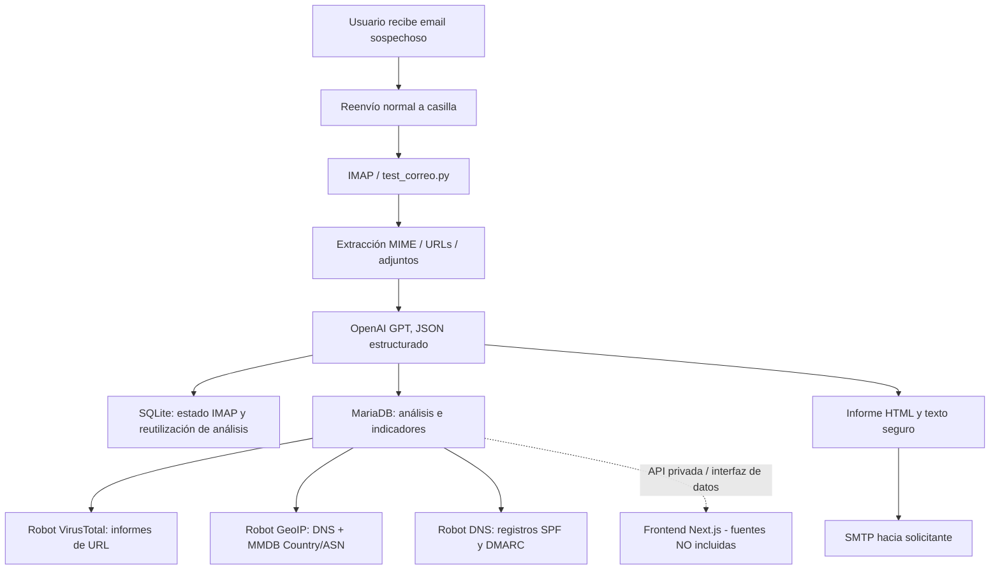

# Arquitectura y flujo de datos

Este repositorio contiene **el backend** de PhishGuardAI. Las fuentes Next.js/React del frontend no fueron entregadas en el ZIP original y, por tanto, no forman parte del repositorio.

## MySQL / MariaDB

| Tabla | Responsabilidad |
|---|---|
| `correos_analizados` | Caso, riesgo, clasificación, evidencias, MITRE, autenticación, DNS, GeoIP, envío. |
| `indicadores_phishing` | Indicadores descriptivos por caso. |
| `eventos_sistema` | Eventos técnicos asociados a casos. |
| `vt_urls` | URL deduplicada (SHA-256), informes VirusTotal y GeoIP. |
| `correo_urls` | Relación muchos a muchos entre casos y URLs. |
| `usuarios` | Usuarios de la aplicación web; **el backend no administra cuentas**. |
| `acciones_analista` | Acciones realizadas por analistas en frontend. |
| `tokens_activacion` | Activación de cuentas frontend. |

La base también contiene un estado SQLite local (`correos.db`) generado al ejecutar. **No se distribuye con el código fuente.** Su eliminación puede alterar la deduplicación y el cursor IMAP. El primer inicio con estado vacío inicializa los UIDs actuales y omite el histórico del buzón.

## Fuentes de evidencia

- **IA**: evaluación textual y de señales estáticas; no sustituye una confirmación humana.
- **VirusTotal**: consulta reportes existentes; `SIN_REPORTE` no significa seguro.
- **GeoIP**: país/ASN de infraestructura, no ubicación del atacante.
- **DNS**: publicación de SPF y política DMARC; no autentica el correo original.
- **Reenvío Gmail V9**: cabeceras citadas son datos no confiables; no generan `PASS`.

## Estados observables

VirusTotal: `PENDIENTE`, `PROCESANDO`, `COMPLETADO`, `SIN_REPORTE`, `ERROR`, `OMITIDA`.

GeoIP: `PENDIENTE`, `COMPLETADO`, `ERROR`, `SIN_IP`, `OMITIDA` (según lógica del robot). El fallo `gaierror` queda como `ERROR` en este código; su clasificación más específica es una mejora futura.

La ejecución independiente de robots puede dejar un informe SMTP enviado antes de que terminen VirusTotal, GeoIP y DNS.
